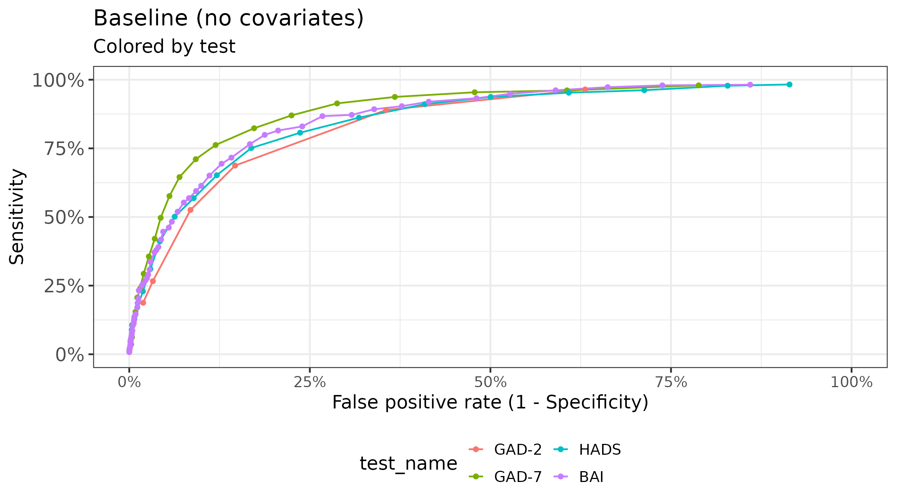
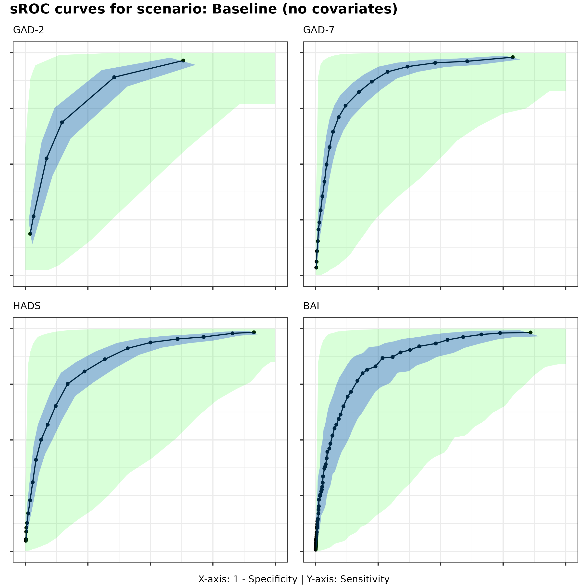
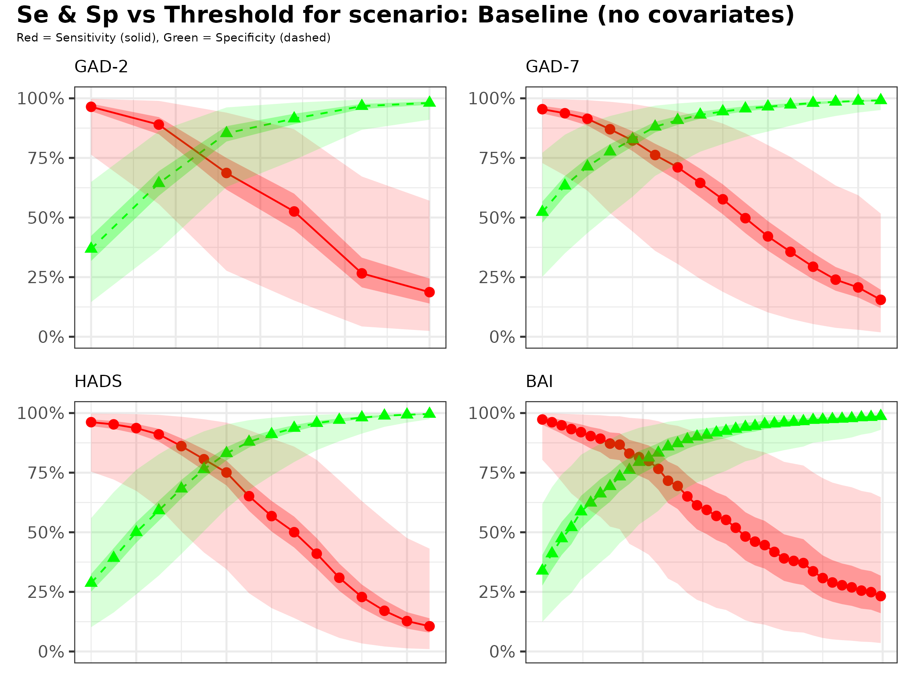
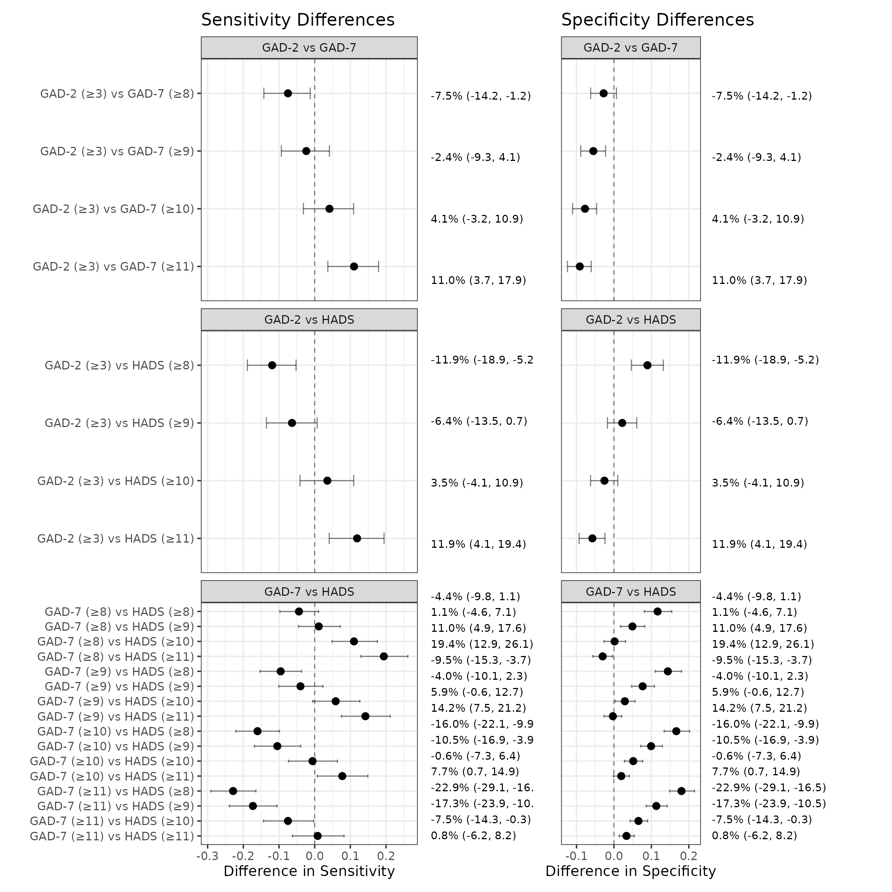
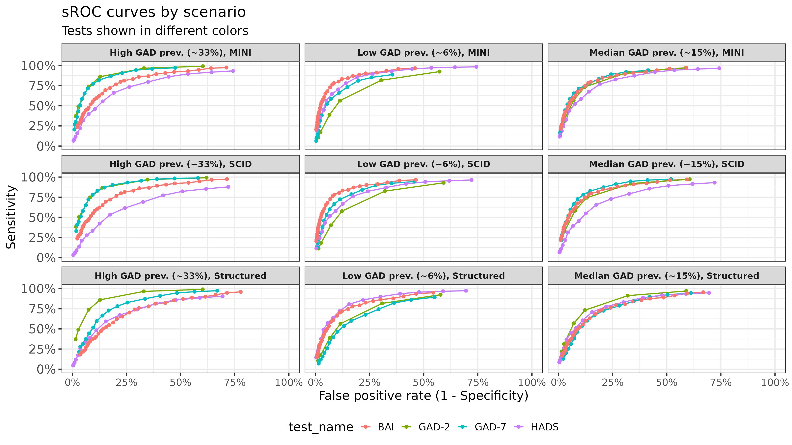

<!-- ------------------------------------------------------------------------------------------------------------------------------- -->
# MetaOrdDTA
<!-- ------------------------------------------------------------------------------------------------------------------------------- -->

[What is MetaOrdDTA?](#what-is-metaorddta) ·
[The models](#the-models) ·
[Installation](#installation) ·
[Examples](#examples) ·
[Simulation study](#simulation-study) ·
[How to cite MetaOrdDTA](#how-to-cite-metaorddta) ·
[References](#references)


<!-- ------------------------------------------------------------------------------------------------------------------------------- -->
## What is MetaOrdDTA?
<!-- ------------------------------------------------------------------------------------------------------------------------------- -->


**MetaOrdDTA** is an R package for the meta-analysis (MA) and network meta-analysis (NMA) of medical tests
(e.g., diagnostic and screening tests) across all of the test thresholds - including unreported (i.e., "missing") thresholds -
using ordinal regression-based models.


Unlike most methods, MetaOrdDTA allows users to input ALL of the data in the analysis
and still produce summary estimates of sensitivity (Se) and specificity (Sp) at every test threshold,
rather than "partitioning" the data at each threshold
(which does not make full use of the data - unless every study reports data at every single test threshold -
which is unfortunately still very rare).


More specifically, MetaOrdDTA enables researchers to do the following two things **simultaneously**:
(i) include all of the available data, regardless of which test threshold(s) the authors of any given study reported the data at, and:
(ii) produce summary estimates of Se and Sp at every threshold - even at the thresholds which some (or most) of the studies did not report.


MetaOrdDTA is built on ordinal regression principles
(e.g., see [Betancourt, 2019](https://betanalpha.github.io/assets/case_studies/ordinal_regression.html)),
and the within-study model is based on that proposed by [Jones et al., 2019](https://pubmed.ncbi.nlm.nih.gov/31571244/);
furthermore, MetaOrdDTA extends previously established models
([Rutter & Gatsonis, 2001](https://onlinelibrary.wiley.com/doi/10.1002/sim.942);
[Reitsma et al., 2005](https://www.jclinepi.com/article/S0895-4356%2805%2900162-9/abstract))
to the case where different studies report different thresholds.


Since MetaOrdDTA models the data as truly ordinal (rather than imposing continuous assumptions),
MetaOrdDTA is particularly suited to questionnaire-based tests (e.g., the GAD-2, HADS and BAI anxiety screening tests);
however, MetaOrdDTA can still be used for continuous tests (e.g., biomarkers),
using either the ordinal models or the Jones model ([Jones et al., 2019](https://pubmed.ncbi.nlm.nih.gov/31571244/)),
which was designed for continuous tests.


All of the models are coded in [Stan](https://mc-stan.org/), and are sampled either using
[cmdstanr](https://mc-stan.org/cmdstanr/) (the default) or using our [NicoStan](https://github.com/CerulloE1996/NicoStan) R package.
Furthermore, MetaOrdDTA provides features such as: K-fold cross-validation (CV) for model selection, meta-regression, AUC estimates,
and plots and tables of the results (e.g., sROC plots, accuracy vs. threshold plots,
and forest plots of the pairwise accuracy differences between tests) -
see the [Examples](#examples) section below for more details.


<!-- ------------------------------------------------------------------------------------------------------------------------------- -->
## The models
<!-- ------------------------------------------------------------------------------------------------------------------------------- -->


MetaOrdDTA can fit the following models
(the names below are the ones we use in our paper - see [How to cite MetaOrdDTA](#how-to-cite-metaorddta) below):


| Model | Description | `model_parameterisation` | `random_thresholds` | MA | NMA |
| --- | --- | --- | --- | --- | --- |
| O-biv-FC | Ordinal-bivariate model, with fixed-effect cutpoints | `"ord_bivariate"` | `FALSE` | Yes | Yes |
| O-biv-RC | Ordinal-bivariate model, with random-effect cutpoints | `"ord_bivariate"` | `TRUE` | Yes | Yes |
| O-HSROC-RC | Ordinal-HSROC model, with random-effect cutpoints | `"ord_HSROC"` | `TRUE` | Yes | No |
| Jones | The "multiple thresholds" model of [Jones et al., 2019](https://pubmed.ncbi.nlm.nih.gov/31571244/) | `"Jones"` | (not used) | Yes | Yes |


More specifically:

- **The ordinal-bivariate models (O-biv-FC and O-biv-RC)** are based on the bivariate model
([Reitsma et al., 2005](https://www.jclinepi.com/article/S0895-4356%2805%2900162-9/abstract))
and on the work of [Xu et al., 2013](https://pubmed.ncbi.nlm.nih.gov/23212851/);
these models do not model a scale parameter (i.e., they assume a scale of 1 in both the diseased and non-diseased groups),
and instead allow both location parameters to be freely estimated,
modelling the between-study correlation **explicitly** (using a bivariate model).
- **The ordinal-HSROC model (O-HSROC-RC)** extends the widely used HSROC model
([Rutter & Gatsonis, 2001](https://onlinelibrary.wiley.com/doi/10.1002/sim.942)) to the "multiple thresholds" case;
hence, unlike the original HSROC model, the O-HSROC-RC model is a "true" ordinal regression model.
Furthermore, just like the standard HSROC model, the O-HSROC-RC model does not model the between-study correlation explicitly;
instead, in the O-HSROC-RC model this correlation is modelled **implicitly**, using shared location and scale parameters in both groups
(i.e., a location of +β in the diseased group and -β in the non-diseased group).
Note that the ordinal-HSROC model has random-effect cutpoints only, since its fixed-cutpoint version is not a valid model.
- **All of the ordinal models** use the "induced-Dirichlet" cutpoint model
([Betancourt, 2019](https://betanalpha.github.io/assets/case_studies/ordinal_regression.html);
[Cerullo et al., 2022](https://onlinelibrary.wiley.com/doi/10.1002/jrsm.1567)).
With fixed-effect cutpoints (`random_thresholds = FALSE`), the induced-Dirichlet model is used as a **prior** model;
this allows users to put priors directly on the "induced" ordinal probabilities (rather than on the "raw" cutpoint parameters),
and hence also to set a "flat" prior on the cutpoints (which is otherwise virtually impossible to do).
On the other hand, with random-effect cutpoints (`random_thresholds = TRUE`),
the induced-Dirichlet model forms part of the between-study model itself (i.e., part of the likelihood - not "only" the prior).
- **The Jones model** ([Jones et al., 2019](https://pubmed.ncbi.nlm.nih.gov/31571244/)) assumes that the test is continuous
(with an optional Box-Cox transformation, set using the `box_cox` argument);
hence, the Jones model is more appropriate for continuous tests,
since the Jones model makes more restrictive assumptions about the data than the ordinal models above.
- **For NMA**, the models are based on the NMA model of [Nyaga et al., 2016](https://journals.sagepub.com/doi/10.1177/0962280216669182);
furthermore, the `compound_symmetry` argument sets whether the test-specific variances within each disease group
are equal to one another (`compound_symmetry = TRUE`) or not (`compound_symmetry = FALSE`).


Note that MetaOrdDTA also contains the standard stratified-bivariate approach
([Reitsma et al., 2005](https://www.jclinepi.com/article/S0895-4356%2805%2900162-9/abstract)),
which dichotomises the data at each observed threshold and fits the standard bivariate model to that subset;
we used this approach as a comparator in our simulation study (see the [Simulation study](#simulation-study) section below).


<!-- ------------------------------------------------------------------------------------------------------------------------------- -->
## Installation
<!-- ------------------------------------------------------------------------------------------------------------------------------- -->


Note that MetaOrdDTA has mainly been tested on Linux (similarly to NicoStan);
if you have any issues, please open an issue here on GitHub.


MetaOrdDTA requires:

- The [cmdstanr](https://mc-stan.org/cmdstanr/) R package and [CmdStan](https://mc-stan.org/users/interfaces/cmdstan)
(see the [cmdstanr installation guide](https://mc-stan.org/cmdstanr/articles/cmdstanr.html)), and:
- Our [NicoStan](https://github.com/CerulloE1996/NicoStan) R package (which also installs NicoSIMD);
note that NicoStan has its own requirements (e.g., a C++17 compiler and [BridgeStan](https://github.com/roualdes/bridgestan)),
so please follow the [NicoStan installation guide](https://github.com/CerulloE1996/NicoStan#installation) first.


First, install cmdstanr and CmdStan, by running the following R code:

```r
## ---- Install the cmdstanr R package:
install.packages("remotes")
remotes::install_github("stan-dev/cmdstanr", force = TRUE)
## ---- Then, install the latest version of CmdStan:
cmdstanr::install_cmdstan(cores = parallel::detectCores(),
                          overwrite = TRUE,
                          cpp_options = list("STAN_MODEL_LDFLAGS" = "-shared",
                                             "CXXFLAGS" = "-fPIC"))
```

Then, install NicoStan (see the [NicoStan installation guide](https://github.com/CerulloE1996/NicoStan#installation) for more details):

```r
remotes::install_github(repo = "CerulloE1996/NicoStan",
                        upgrade = "never")
NicoStan::install_NicoStan()
```

Finally, restart R, and install MetaOrdDTA by running the following R code:

```r
remotes::install_github(repo = "CerulloE1996/MetaOrdDTA",
                        upgrade = "never")
```


<!-- ------------------------------------------------------------------------------------------------------------------------------- -->
## Examples
<!-- ------------------------------------------------------------------------------------------------------------------------------- -->


[The data](#the-data) ·
[Model fitting](#model-fitting) ·
[Model selection using K-fold CV](#model-selection-using-k-fold-cv) ·
[Area under the curve (AUC)](#area-under-the-curve-auc) ·
[Plots: sROC](#plots-sroc) ·
[Plots: Accuracy vs. threshold](#plots-accuracy-vs-threshold) ·
[Plots: Pairwise accuracy differences](#plots-pairwise-accuracy-differences) ·
[Meta-regression](#meta-regression)


In this section, we demonstrate the MetaOrdDTA R package using a network meta-analysis (NMA) example
of four anxiety screening tests (the GAD-2, GAD-7, HADS and BAI);
this is the same example as in section 5 of our paper (see [How to cite MetaOrdDTA](#how-to-cite-metaorddta) below).
All of the example code is in the [inst/examples](inst/examples) folder, in the R files whose names start with "NMA_example"
(e.g., for the sROC plots, it is the [NMA_example_plots_sROC.R](inst/examples/NMA_example_plots_sROC.R) file which contains the full R code).


Note that the results presented in this section use simulated data, generated for methodological demonstration only;
hence, these estimates should NOT be interpreted as clinical findings or used for clinical decision-making.


### The data


For NMA, MetaOrdDTA takes the data as a nested list (`x`), with one element per test (4 in our example: GAD-2, GAD-7, HADS and BAI),
each holding two matrices - the first for the non-diseased group and the second for the diseased group -
with one row per study (80 in our example) and one column more than the number of thresholds of that test
(e.g., 7 columns for the GAD-2, 22 for the GAD-7 and HADS, and 64 for the BAI).


In the first column, each row holds the study's total number of non-diseased (or diseased) individuals;
from column #2 onwards, each cell holds the cumulative number of individuals scoring at or above each threshold
(i.e., increasing the column count represents increased disease severity required to test positive).
Hence, the counts must decrease monotonically from left to right, and missing data are indicated by -1 values.


Furthermore, the `indicator_index_test_in_study` matrix (one row per study, one column per test)
indicates which tests each study evaluated (1 = present, 0 = absent).
Note that, for standard (non-NMA) meta-analyses, `indicator_index_test_in_study` can be omitted,
and `x` is simply the list of the two matrices of the one test.


### Model fitting


```r
## ---- Initialise the model (a new R6 class object):
model_prep_obj <- MetaOrdDTA::MetaOrd_model$new(
      x = x, ## The data
      indicator_index_test_in_study = indicator_index_test_in_study,
      intercept_only = TRUE, ## i.e., no meta-regression
      network = TRUE,
      compound_symmetry = TRUE, ## Only relevant for NMA
      model_parameterisation = "ord_bivariate",
      random_thresholds = FALSE) ## i.e., the O-biv-FC model
## ---- Extract (and optionally modify) the priors before sampling:
priors <- model_prep_obj$priors
priors$prior_beta_sigma_SD[2] <- 1.0 ## default is: c(0.5, 0.5)
## ---- Sample the model using the "$sample()" R6 method:
model_samples_obj <- model_prep_obj$sample(
      n_chains = 16,
      n_burnin = 1000,
      n_iter   = 1000,
      priors = priors) ## (set algorithm = "NicoStan" to sample with NicoStan instead of cmdstanr)
## ---- Summaries, parameters and MCMC diagnostics:
model_summary_and_trace_obj <- model_samples_obj$summary()
tibble_main <- model_summary_and_trace_obj$get_summary_main()
Se <- model_summary_and_trace_obj$extract_params(params = c("Se_baseline"))
Sp <- model_summary_and_trace_obj$extract_params(params = c("Sp_baseline"))
model_summary_and_trace_obj$get_divergences()
model_summary_and_trace_obj$get_HMC_info()
## ---- MCMC plots:
model_summary_and_trace_obj$plot_traces()
model_summary_and_trace_obj$plot_densities()
```


The model fitting workflow above consists of the following steps:

1. Model initialisation, using the `MetaOrd_model$new()` R6 class method,
with the data and the model specifications (here, the O-biv-FC model, i.e., `model_parameterisation = "ord_bivariate"`
and `random_thresholds = FALSE`; see [The models](#the-models) above).
2. (Optional) prior and/or initial value modification - extracting and customising the priors and/or initial values before sampling.
3. MCMC sampling, using the `$sample()` method, to obtain the model samples object (here named `model_samples_obj`).
4. Results extraction, using the `$summary()` method, to obtain the model summary and traces object
(here named `model_summary_and_trace_obj`).
5. Parameter extraction, including: the summary tibbles of the Stan model blocks
(e.g., `$get_summary_main()` for the Stan parameters block), and specific parameters, using `$extract_params()`;
note that all of the tibbles include the ESS and R-hat, for convergence assessment.
6. MCMC diagnostics: extracting the HMC sampler information (e.g., the divergences), and optionally plotting trace and density plots;
for this step, we recommend at least checking the divergences, using the `$get_divergences()` method.


Note that, since we are not doing meta-regression here (see the [Meta-regression](#meta-regression) section below),
we must set `intercept_only = TRUE`;
furthermore, `compound_symmetry = TRUE` sets all of the test-specific variances within each disease group to be equal to one another
(`compound_symmetry` is only needed for NMA).


### Model selection using K-fold CV


```r
## ---- Make the folds (always use the same seed and folds when comparing models):
fold_assignments <- model_summary_and_trace_obj$make_folds_k_fold_CV(seed = 123,
                                                                     K = 5) ## number of folds
## ---- Then, run K-fold CV for the model (and likewise for every other model compared):
kfold_Model_A <- model_summary_and_trace_obj$run_k_fold_CV(seed = 123,
                                                           fold_assignments = fold_assignments,
                                                           n_burnin = 1000,
                                                           n_iter = 1000,
                                                           n_chains = 2,
                                                           parallel = TRUE,
                                                           n_workers = 5)
## ---- Compare the K-fold results of the four models, and rank them by ELPD:
kfold_results_list <- list(kfold_Model_A, kfold_Model_B, kfold_Model_C, kfold_Model_D)
model_names <- c("Model_A (FIXED-C + CS)", "Model_B (FIXED-C + UN)",
                 "Model_C (RAND-C + CS)", "Model_D (RAND-C + UN)")
comparison <- MetaOrdDTA::compare_models_k_fold_CV(kfold_results_list = kfold_results_list,
                                                   model_names = model_names,
                                                   min_ess_threshold = 100)
MetaOrdDTA::summarise_model_comparison_k_fold_CV(comparison)
MetaOrdDTA::make_latex_table_k_fold_CV(comparison) ## LaTeX code of a table of the results
```


K-fold CV is run using the `$make_folds_k_fold_CV()` and `$run_k_fold_CV()` R6 class methods;
the `compare_models_k_fold_CV()` helper function then compares any number of models
(discarding any folds, across all models, with an ESS below 100 by default -
this threshold can be changed using the `min_ess_threshold` argument),
and `summarise_model_comparison_k_fold_CV()` ranks the models by ELPD.
We use K-fold CV since K-fold CV directly evaluates predictive performance on held-out studies;
furthermore, for hierarchical NMA models, leave-one-out CV (LOO-IC) fails systematically,
since removing a single study substantially affects the between-study variance structure,
yielding Pareto k-hat values above 0.7 for most observations ([Vehtari et al., 2017](https://doi.org/10.1007/s11222-016-9696-4)),
whereas K-fold CV with several studies per fold gives stable out-of-sample predictions.


In our example, Model A (i.e., the O-biv-FC model, with compound symmetry) had the highest ELPD:

| Rank | Model | ELPD (SE) | ΔELPD (SE) |
| --- | --- | --- | --- |
| 1 | Model_A (FIXED-C + CS) | -24881 (1960) | (best) |
| 2 | Model_B (FIXED-C + UN) | -25338 (1849) | -457 (2695) |
| 3 | Model_C (RAND-C + CS) | -27581 (2392) | -2699 (3093) |
| 4 | Model_D (RAND-C + UN) | -28139 (2269) | -3258 (2998) |

ELPD = expected log pointwise predictive density (higher is better).<br>
FIXED-C = fixed-effect cutpoints (i.e., the O-biv-FC model).<br>
RAND-C = random-effect cutpoints (i.e., the O-biv-RC model).<br>
CS = compound symmetry.<br>
UN = unstructured.


### Area under the curve (AUC)


```r
outs_AUC <- model_summary_and_trace_obj$extract_AUC(test_names = test_names)
outs_AUC$outs_AUC$auc      ## the AUC of each test
outs_AUC$outs_AUC$auc_pred ## the AUC prediction intervals
outs_AUC$outs_AUC$auc_diff ## the pairwise differences in AUC between the tests
cat(MetaOrdDTA::create_AUC_latex_table(auc_outs = outs_AUC$outs_AUC)) ## LaTeX code of a table of the results
```


The AUC of each test - and the pairwise differences in AUC between the tests - are obtained using the `$extract_AUC()` R6 class method,
and the `create_AUC_latex_table()` function gives the LaTeX code of a table of these results;
note that the prediction intervals incorporate the between-study heterogeneity.


### Plots: sROC


```r
## ---- Thresholds to show for each test (optional - otherwise shows all thresholds):
relevant_thresholds <- list("GAD-2" = c(1:6),
                            "GAD-7" = c(3:18),
                            "HADS"  = c(3:18),
                            "BAI"   = c(3:38))
outs_plots_sROC <- model_summary_and_trace_obj$plot_sROC(test_names = test_names,
                                                         relevant_thresholds = relevant_thresholds)
outs_plots_sROC$all_tests           ## all of the tests on a single panel
outs_plots_sROC$panels_with_regions ## one panel per test, with 95% credible and prediction regions
```


The `$plot_sROC()` R6 class method gives two sROC plots.
The first sROC plot shows the sROC curve of each test on a single panel, with each curve coloured by test:



The second sROC plot shows the sROC curve of each test on its own panel,
together with the 95% credible regions (shaded in blue by default) and the 95% prediction regions (shaded in green by default):




Furthermore, users can customise both plots, using two R lists:
`by_scenario_sROC_settings` (for the first plot) and `by_scenario_grid_separate_sROC_settings` (for the second plot).
More specifically, the first R list can take the following options:
`base_size`, `point_size`, `line_size`, `rows_in_legend` and `legend_position`
(as well as options for adding the credible and prediction regions, although we would not recommend this for this plot,
because of the overlap - unless perhaps only 2 or 3 tests are being evaluated);
furthermore, the second R list can take all of the above, in addition to `conf_region_colour` and `pred_region_colour`.


### Plots: Accuracy vs. threshold


```r
outs_plots_thr <- model_summary_and_trace_obj$plot_threshold(test_names = test_names,
                                                             plot_type = "both", ## either "Se", "Sp" or "both"
                                                             relevant_thresholds = relevant_thresholds)
outs_plots_thr$all_tests_combined_Se_and_Sp  ## all of the tests on a single panel
outs_plots_thr$panels_with_regions_Se_and_Sp ## one panel per test, with 95% credible and prediction bands
```


Similarly to the sROC plots, the `$plot_threshold()` R6 class method gives two plots - which, besides the different type of curves,
are quite analogous to the corresponding sROC plots:
the first shows the Se and/or Sp curve of each test on a single panel, and the second shows the curves of each test on its own panel,
together with the 95% credible bands (slightly darker shading) as well as the 95% prediction bands (very light shading).
By default, all of the sensitivity curves and bands are shown in red, and all of the specificity curves and bands in green:




Note that the `plot_type` argument can be set to either "Se", "Sp" or "both";
if "Se" (or "Sp") is specified, then only the sensitivity (or specificity) curves are shown, but otherwise the plots look the same.


### Plots: Pairwise accuracy differences


```r
## ---- Thresholds to compare (e.g., the typical screening thresholds of each test):
thr_screening <- list("GAD-2" = c(3),
                      "GAD-7" = c(8, 9, 10),
                      "HADS"  = c(9, 10, 11)) ## only these tests (and thresholds) are shown
baseline_plot_settings <- list()
baseline_plot_settings$show_values <- TRUE ## also shows the posterior medians and 95% CrI's of the pairwise differences
## ---- Plot the Se and Sp pairwise differences as forest plots, using the "$plot_pairwise()" R6 class method:
outs_plot_pairwise <- model_summary_and_trace_obj$plot_pairwise(comparison_type = "both",
                                                                test_names = test_names, ## all four tests, in the order of the model
                                                                relevant_thresholds = thr_screening,
                                                                baseline_plot_settings = baseline_plot_settings)
outs_plot_pairwise$Se       ## Se pairwise differences only
outs_plot_pairwise$Sp       ## Sp pairwise differences only
outs_plot_pairwise$combined ## Se and Sp pairwise differences, side-by-side
## ---- The pairwise differences themselves (as a tibble), using the "$extract_NMA_comparisons()" R6 class method:
outs_NMA_comp <- model_summary_and_trace_obj$extract_NMA_comparisons(test_names = test_names)
```


The `$extract_NMA_comparisons()` method computes the Se and Sp pairwise differences between the tests from the full posterior traces,
and the `$plot_pairwise()` method plots them as forest plots;
with `show_values = TRUE`, the estimates (i.e., the posterior medians and 95% credible intervals) are shown alongside:




Other options which can be passed via the R list `baseline_plot_settings` include the following:
`base_size`, `point_size`, `error_bar_width`, `error_bar_alpha`, `y_axis_text_size_multiplier`,
`show_values` (as we already mentioned), `value_size_multiplier`, `ratio_plot` and `ratio_text`.


### Meta-regression


Meta-regression (i.e., study-level) covariates are inputted either directly, as the list of covariate matrices `X`,
or, as we do here, starting from covariate tibbles (one per test, with one row per study);
our example has four covariates:
one continuous (logit-transformed disease prevalence), two categorical (study setting and reference standard)
and one binary (risk of bias [RoB]).
MetaOrdDTA turns these covariates into `X` - with test-specific covariates for NMA, since covariates such as prevalence can differ
between the tests within the same study - and sets the baseline cases
(i.e., the covariate profile of the summary sensitivity and specificity; by default, the reference categories of all of the covariates):

```r
test_names <- c("GAD-2", "GAD-7", "HADS", "BAI")
test_data_list <- list(data_gad2, data_gad7, data_HADS, data_BAI)
NMA_data <- MetaOrdDTA::prepare_NMA_data(test_data_list = test_data_list,
                                         test_names = test_names,
                                         max_scores = c(6, 21, 21, 63))
## ---- Create the test-specific covariate matrices
## ---- (cov_data_per_test: a list with one covariate tibble per test, with one row per study):
covs_output <- MetaOrdDTA::create_subsetted_covariates_for_tests(
      cov_data = cov_data_per_test,
      indicator_index_test_in_study = NMA_data$indicator_index_test_in_study,
      test_names = test_names,
      continuous_covs = c("logit_prev_GAD"),
      binary_covs = c("RoB_low"),
      categorical_covs = c("study_setting", "Ref_test"),
      center_and_scale_cts = TRUE) ## standardise the continuous covariates
## ---- Baseline cases (default: intercept = 1, all other covariates = 0, i.e., the reference categories):
X <- covs_output$X
baseline_vec <- c(1, rep(0, ncol(X[[1]][[1]]) - 1))
baseline_case_nd <- rep(list(baseline_vec), NMA_data$n_index_tests)
baseline_case_d  <- rep(list(baseline_vec), NMA_data$n_index_tests)
cov_data <- list(X = MetaOrdDTA::expand_covariates_to_all_studies(X,
                                                                  indicator_index_test_in_study = NMA_data$indicator_index_test_in_study),
                 baseline_case_nd = baseline_case_nd,
                 baseline_case_d  = baseline_case_d)
```


The model is then fitted as in the [Model fitting](#model-fitting) section above,
except that we must specify `intercept_only = FALSE` and provide the `cov_data` structure from the code above:

```r
model_prep_obj <- MetaOrdDTA::MetaOrd_model$new(
      x = NMA_data$x,
      indicator_index_test_in_study = NMA_data$indicator_index_test_in_study,
      intercept_only = FALSE, ## FALSE for meta-regression
      cov_data = cov_data,
      network = TRUE,
      compound_symmetry = TRUE,
      model_parameterisation = "ord_bivariate",
      random_thresholds = FALSE)
model_samples_obj <- model_prep_obj$sample(n_chains = 16,
                                           n_burnin = 1000,
                                           n_iter = 1000)
MR_model_summary_and_trace_obj <- model_samples_obj$summary()
beta_mu <- MR_model_summary_and_trace_obj$extract_params(params = c("beta_mu")) ## the meta-regression coefficients
```


Covariate selection uses the same K-fold CV functions as the [Model selection using K-fold CV](#model-selection-using-k-fold-cv)
section above; the only difference is that here we compare all of the possible covariate combinations.
Note that we recommend against only doing univariate meta-regression and building up from there,
since one may then miss important multi-variable patterns.


The meta-regression coefficients, and the heterogeneity of the meta-regression model vs. the intercept-only model,
can then be tabulated (as LaTeX code):

```r
## ---- Coefficients table (the columns of X must be named):
MR_coeff_outs <- MetaOrdDTA::map_beta_coefficients(beta_tibble = beta_mu,
                                                   covariate_names = dimnames(X[[1]][[1]])[[2]],
                                                   test_names = test_names)
cat(MetaOrdDTA::create_metareg_coef_table(beta_tibble = MR_coeff_outs$full_table,
                                          test_names = test_names))
## ---- Heterogeneity comparison (meta-regression vs. intercept-only) table:
cat(MetaOrdDTA::create_heterogeneity_comparison_table(MR_model_summary_and_trace_obj = MR_model_summary_and_trace_obj,
                                                      Intercept_only_model_summary_and_trace_obj = model_summary_and_trace_obj,
                                                      compound_symmetry = TRUE))
```


Furthermore, MetaOrdDTA enables efficient post-hoc exploration of how different covariate profiles affect test performance,
without refitting the model:
the `$recompute_baseline()` R6 class method recomputes the posterior distributions of the summary accuracy for new baseline cases
(i.e., covariate "scenarios"), after which the AUC, sROC, accuracy vs. threshold and pairwise differences methods above
give the results of every scenario:

```r
## ---- The covariate values of each scenario (e.g., prevalence x reference standard):
all_MR_scenarios <- list("Low GAD prev. (~6%), \nMINI"   = list(logit_prev_GAD = -1.0, Ref_test_clean_SCID = 0, Ref_test_clean_Structured = 0),
                         "Median GAD prev. (~15%), \nMINI" = list(logit_prev_GAD =  0.0, Ref_test_clean_SCID = 0, Ref_test_clean_Structured = 0),
                         "High GAD prev. (~33%), \nMINI"   = list(logit_prev_GAD = +1.0, Ref_test_clean_SCID = 0, Ref_test_clean_Structured = 0))
                         ## ... and likewise for the SCID and "Structured" reference standards ...
MR_baseline_outs <- MR_model_summary_and_trace_obj$recompute_baseline(test_names = test_names,
                                                                     MR_scenarios = all_MR_scenarios)
outs_plots_sROC <- MR_model_summary_and_trace_obj$plot_sROC(test_names = test_names,
                                                            relevant_thresholds = relevant_thresholds)
```




<!-- ------------------------------------------------------------------------------------------------------------------------------- -->
## Simulation study
<!-- ------------------------------------------------------------------------------------------------------------------------------- -->


In our paper, we compared ten models for ordinal diagnostic tests (six of them Bayesian) in a simulation study
based on the real data of three anxiety screening tests: the GAD-2 (7 categories), the HADS (22 categories) and the BAI (64 categories);
more specifically, we simulated data with around 15%, 40% and 70% of the threshold data missing, with 10 and 50 studies,
under seven data-generating models (DGMs): three ordinal DGMs (O-biv-FC, O-biv-RC and O-HSROC-RC)
and four continuous DGMs (Jones, Hoyer, Logit-GLMM and Steinhauser), and under three sets of priors.


Overall (prior set 0), the two O-bivariate models had the lowest mean RMSE and bias:

| Rank | Model | Reference | R package | RMSE | Bias |
| --- | --- | --- | --- | --- | --- |
| 1 | O-biv-RC | Proposed | MetaOrdDTA | 4.33 | 0.92 |
| 2 | O-biv-FC | Proposed | MetaOrdDTA | 4.36 | 0.93 |
| 3 | Jones (own priors) | Jones et al., 2019 | MetaOrdDTA | 4.47† | 1.40* |
| 4 | Jones (matching priors) | Jones et al., 2019 | MetaOrdDTA | 4.50† | 1.56* |
| 5 | O-HSROC-RC | Proposed | MetaOrdDTA | 4.93* | 2.09* |
| 6 | Steinhauser (DIDS) | Steinhauser et al., 2016 | diagmeta | 5.08* | 2.40* |
| 7 | Logit-GLMM | Hoyer & Kuss, 2018 | lme4 | 5.38* | 2.56* |
| 8 | Strat-biv | Reitsma et al., 2005 | MetaOrdDTA | 5.42* | 1.09* |
| 9 | Hoyer | Hoyer et al., 2018 | dtametaTMB | 5.59* | 2.83* |
| 10 | Steinhauser (CICS) | Steinhauser et al., 2016 | diagmeta | 6.04* | 3.11* |

RMSE and Bias = mean, across the 112 scenarios in which every model has a result, of RMSE(Se) + RMSE(Sp)
and of |bias(Se)| + |bias(Sp)| (percentage points).<br>
\* = significantly worse than the best-ranked model of the same column, both statistically
(a difference in means of at least 4 × the larger of the two MCSEs of the means) and practically (at least 10% higher).<br>
† = statistically, but not practically, worse than the best-ranked model of the same column.<br>
Jones (own priors) = the Jones model with its own priors.<br>
Jones (matching priors) = the Jones model with priors on Se and Sp matched to those of our models.


However, the two O-bivariate models had almost the same mean RMSE (4.33 vs. 4.36) and mean bias (0.92 vs. 0.93);
hence, we consider the O-biv-FC model the better choice, since the O-biv-FC model is simpler and more of its fits were kept.


All of the code of the simulation study is in the [sim_study](sim_study) folder;
furthermore, the results of every scenario are in
[Sim_study_results_of_every_scenario.csv](sim_study/factorial_design_of_missing_thresholds/Sim_study_results_of_every_scenario.csv),
and the R functions in
[QC_functions_that_make_every_table_from_the_outputs.R](sim_study/QC_functions_that_make_every_table_from_the_outputs.R)
make every results table of the paper again, straight from the scored outputs (for quality control).


<!-- ------------------------------------------------------------------------------------------------------------------------------- -->
## How to cite MetaOrdDTA
<!-- ------------------------------------------------------------------------------------------------------------------------------- -->


If you use MetaOrdDTA, please cite our paper:

Cerullo E, Linde K, Jones HE, Derezea E, Lucas T, Cooper NJ, Sutton AJ.
Ordinal regression for meta-analysis of test accuracy: a flexible approach for utilizing all threshold data.
arXiv: [2505.23393](https://arxiv.org/abs/2505.23393).


<!-- ------------------------------------------------------------------------------------------------------------------------------- -->
## References
<!-- ------------------------------------------------------------------------------------------------------------------------------- -->


**Stan:** Stan Development Team, Stan Reference Manual. <https://mc-stan.org>

**cmdstanr** R package: Gabry J, Češnovar R, Johnson A, Bronder S. cmdstanr: R Interface to 'CmdStan'. <https://github.com/stan-dev/cmdstanr>

**NicoStan** R package: <https://github.com/CerulloE1996/NicoStan>

**Betancourt, 2019:** Ordinal regression (case study). <https://betanalpha.github.io/assets/case_studies/ordinal_regression.html>

**Cerullo et al., 2022:** <https://onlinelibrary.wiley.com/doi/10.1002/jrsm.1567>

**Jones et al., 2019:** <https://pubmed.ncbi.nlm.nih.gov/31571244/>

**Nyaga et al., 2016:** <https://journals.sagepub.com/doi/10.1177/0962280216669182>

**Reitsma et al., 2005:** <https://www.jclinepi.com/article/S0895-4356%2805%2900162-9/abstract>

**Rutter & Gatsonis, 2001:** <https://onlinelibrary.wiley.com/doi/10.1002/sim.942>

**Vehtari et al., 2017:** <https://doi.org/10.1007/s11222-016-9696-4>

**Xu et al., 2013:** <https://pubmed.ncbi.nlm.nih.gov/23212851/>
